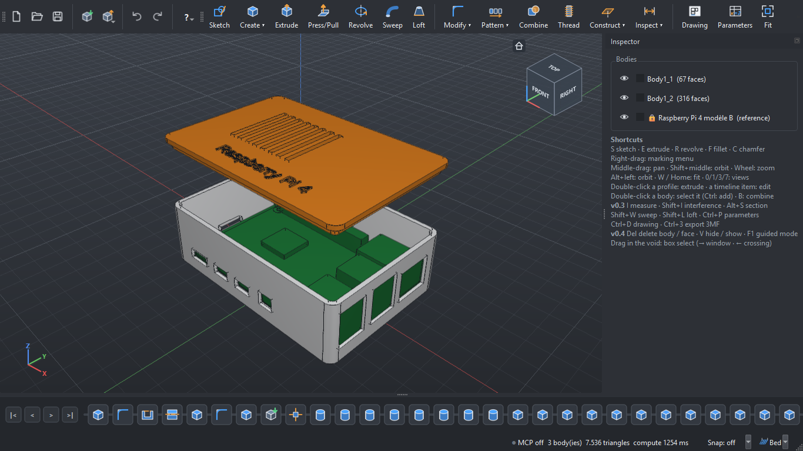
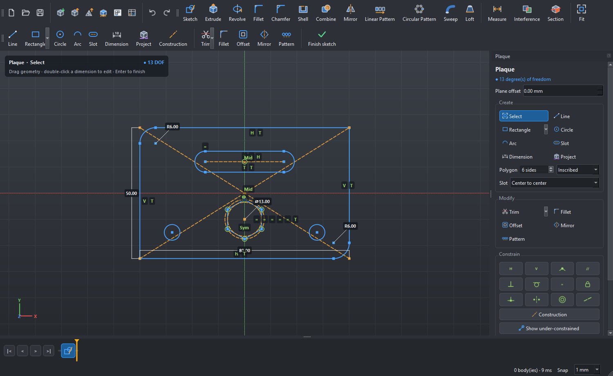
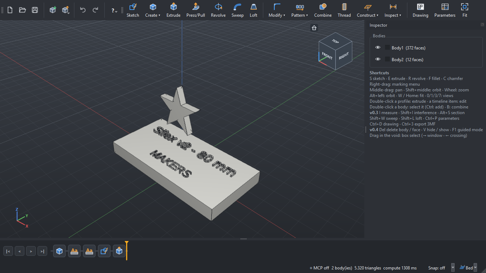
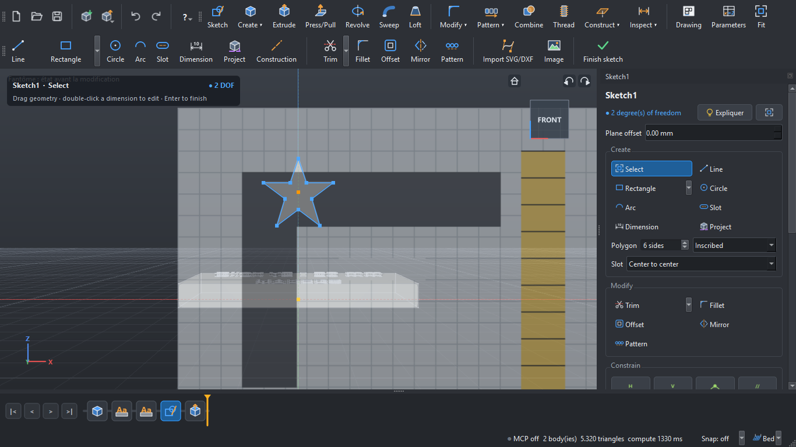
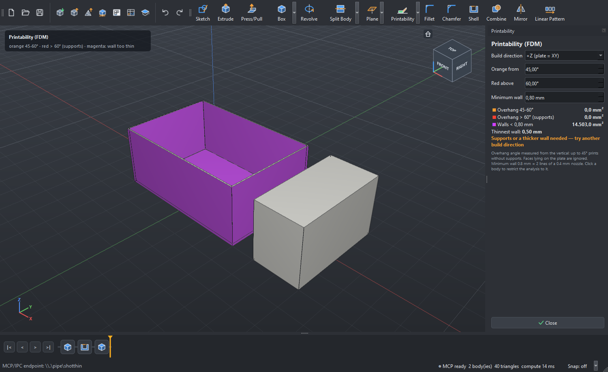
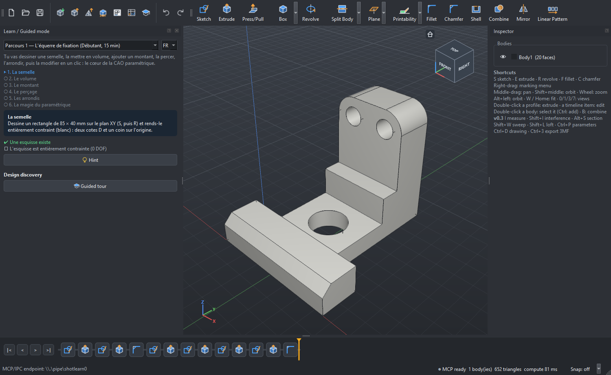

<div align="center">

# Silex

**Le logiciel de 3D gratuit pour concevoir des pièces à imprimer, simplement.**

Dessine, cote, imprime. Change une cote, tout suit.



*Un boîtier pour Raspberry Pi 4 prêt à imprimer : ouvertures pour l'Ethernet, les USB, l'alimentation USB-C, les
deux micro HDMI, la prise audio et la carte micro SD, entretoises, couvercle ventilé avec logo gravé.
À ouvrir dans [`examples/boitier_raspberry_pi4.silex`](examples/boitier_raspberry_pi4.silex).*

### [⬇️ Télécharger Silex 0.7 pour Windows](https://github.com/fgo-droid/SilexCAD/releases/download/v0.7.0/Silex-0.7.0-windows-x64.zip)

*Gratuit · 48 Mo · rien à installer · Windows 10 et 11 (64 bits)*

[Découvrir](#ce-que-tu-peux-faire-avec-silex) · [Installer](#installer-silex) · [Toutes les versions](https://github.com/fgo-droid/SilexCAD/releases) · [Manuel utilisateur](docs/manual/Silex_Manuel_utilisateur.docx) · [Guide technique](docs/DEVELOPPEMENT.md)

</div>

---

## Pourquoi Silex ?

Tu as une imprimante 3D, une idée de pièce, et pas envie de passer trois semaines à apprendre un logiciel
de CAO professionnel ? Silex est fait pour toi.

- 🎯 **Pensé pour les makers.** Trous pour vis et inserts, filetages qui se vissent vraiment une fois imprimés,
  boîtiers pour cartes électroniques, alerte quand une paroi est trop fine pour ta buse.
- 🧠 **Il retient la recette, pas seulement la forme.** Ta pièce est une suite d'étapes. Tu changes une cote au
  début, tout le reste se recalcule. Plus besoin de tout redessiner.
- 🎓 **Il t'apprend en chemin.** 9 parcours guidés, des défis de dépannage, et un bouton **Expliquer** qui te dit
  en français ce qui manque à ton dessin.
- 🤖 **Il se pilote avec une IA.** Décris ta pièce à Claude ou Gemini, et regarde-la se construire en direct.
- 💾 **Il ne te fait pas perdre ton travail.** Sauvegarde automatique toutes les 2 minutes et récupération
  après un plantage.
- 🆓 **Il est libre et gratuit.** Licence MIT, aucun compte à créer, aucun abonnement, rien à installer :
  un dossier que tu copies où tu veux, même sur une clé USB.

## Ce que tu peux faire avec Silex

### Dessiner en 2D, puis passer en 3D

Trace un rectangle, un cercle, un oblong ou un hexagone. Ajoute des cotes. Silex te montre en couleur ce qui est
bien défini (blanc) et ce qui peut encore bouger (bleu). Puis tire ton dessin en volume, perce, arrondis les
angles.



### Écrire sur tes pièces, avec des textes qui se mettent à jour 🆕

Grave un nom, une version ou une cote sur ta pièce, en relief ou en creux. Écris `Boîte {largeur} mm` : si tu
changes la largeur de 80 à 100 mm, le texte devient « Boîte 100 mm » tout seul.



### Importer tes dessins et tes photos 🆕

- **SVG et DXF** : récupère un logo d'Inkscape ou un contour de découpe laser, et transforme-le en volume.
- **Photo de référence** : pose la pièce cassée à côté d'une règle, prends-la en photo, glisse la photo sous ton
  dessin et calibre-la en 2 clics. Il ne reste qu'à décalquer.



### Préparer l'impression sans mauvaise surprise

| | |
| --- | --- |
| **Contrôle d'imprimabilité** | Les surplombs qui demandent des supports apparaissent en orange et rouge, les parois trop fines en magenta. |
| **Plateau de ton imprimante** | Prusa, Bambu Lab, Ender 3… Silex t'avertit si ta pièce ne rentre pas. |
| **Vis, inserts et écrous** | Les trous M2 à M6 ont directement les bonnes cotes, avec le jeu qu'il faut pour l'impression. |
| **Emboîtements** | Silex vérifie que le couvercle rentre dans la boîte, avec le bon jeu. |
| **Grandes pièces** | Silex coupe une pièce trop grande en deux, avec des pions pour la recoller sans décalage. |
| **Export** | STL, 3MF (plusieurs pièces et leurs couleurs dans un seul fichier), STEP, et plans 2D en PDF. |



### Apprendre, ou faire apprendre

Silex a été pensé pour les débutants, les ateliers, les FabLabs et les écoles :

- **9 parcours guidés**, du débutant à l'avancé. Chaque étape se valide toute seule quand ton modèle est bon.
- **5 défis de dépannage** : une pièce cassée à réparer en 5 minutes.
- **Mode Essentiel** : une barre d'outils réduite à 7 commandes pour bien démarrer.
- **Pour les formateurs** : un enregistreur qui transforme ta pièce en leçon, et un **tuteur IA** qui guide les
  élèves par des questions, sans jamais faire le travail à leur place.



### Et aussi…

Mise en plan 2D cotée, coupes, mesures, vérification des collisions, balayages et lissages, symétries et
répétitions, matériaux et estimation du poids, bibliothèque de cartes électroniques (Raspberry Pi, ESP32,
Arduino…), import de fichiers STEP de fabricants.

## Installer Silex

Silex fonctionne sous **Windows 10 et 11 (64 bits)**.

1. Télécharge [**Silex-0.7.0-windows-x64.zip**](https://github.com/fgo-droid/SilexCAD/releases/download/v0.7.0/Silex-0.7.0-windows-x64.zip)
   (48 Mo). Les autres versions et leurs notes sont sur la page [Releases](https://github.com/fgo-droid/SilexCAD/releases).
2. Décompresse-le où tu veux : bureau, `C:\Silex`, clé USB…
3. Double-clique sur `silex.exe`. C'est tout.

Au premier lancement, Windows SmartScreen peut afficher « Windows a protégé votre ordinateur », parce que
`silex.exe` n'est pas signé numériquement : clique sur *Informations complémentaires* puis *Exécuter quand même*.

Si Windows signale qu'il manque `MSVCP140.dll`, installe le *Visual C++ Redistributable* de Microsoft :

```powershell
winget install Microsoft.VCRedist.2015+.x64
```

Pour vérifier que tout est en place : `.\silex.exe --doctor | Out-Host` affiche un rapport `[OK]` / `[FAIL]`.

## Bien démarrer

1. Ouvre le [**manuel utilisateur**](docs/manual/Silex_Manuel_utilisateur.docx) : il explique tout pas à pas,
   avec un tutoriel complet.
2. Ou lance directement Silex et appuie sur **F1** : choisis le parcours « Équerre de fixation » (débutant),
   il t'accompagne pour dessiner ta première pièce.
3. Tu peux aussi ouvrir les exemples du dossier [`examples/`](examples/) : chaque pièce y est expliquée
   étape par étape.

## Piloter Silex avec une IA

Silex peut être piloté par un assistant IA (Claude Code, Gemini CLI…) grâce au protocole **MCP**.
Tu écris par exemple :

> « Dessine un boîtier de 80 × 50 × 30 mm à parois de 2 mm, ajoute 4 trous pour vis M3, grave “Prototype v1”
> sur le couvercle et exporte-le en STL. »

L'assistant construit la pièce étape par étape, et tu la vois se dessiner dans Silex. Chaque étape reste
modifiable à la main ensuite. La mise en place est décrite dans le manuel (§ 4.12) et dans le
[guide technique](docs/DEVELOPPEMENT.md#pilotage-par-une-ia-mcp).

## Pour les développeurs

Silex est écrit en C++20 avec **OpenCascade** (le moteur 3D), **Qt 6** (l'interface) et **PlaneGCS** (le solveur
de contraintes de FreeCAD). Architecture, compilation, tests et outils MCP : voir le
[**guide technique**](docs/DEVELOPPEMENT.md).

## Licence

Silex est un logiciel libre sous [licence MIT](LICENSE) : tu peux l'utiliser, le modifier et le partager, même
pour un usage commercial. Les bibliothèques utilisées gardent leur propre licence : voir
[THIRD-PARTY-NOTICES.txt](THIRD-PARTY-NOTICES.txt).
